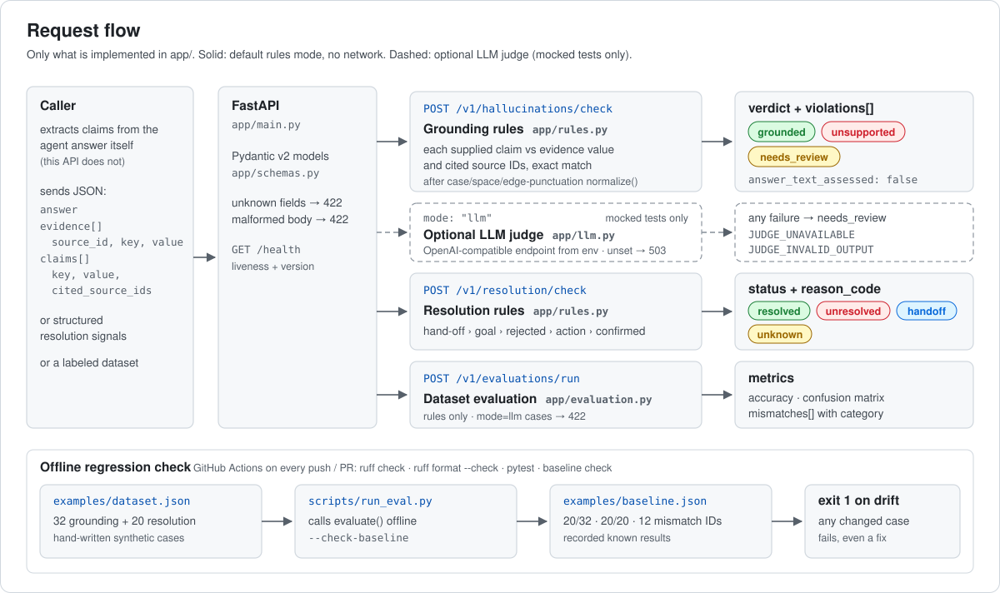
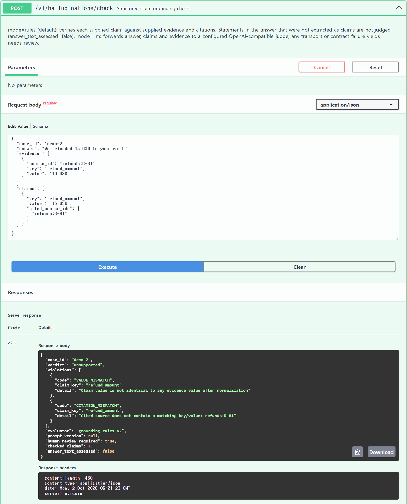
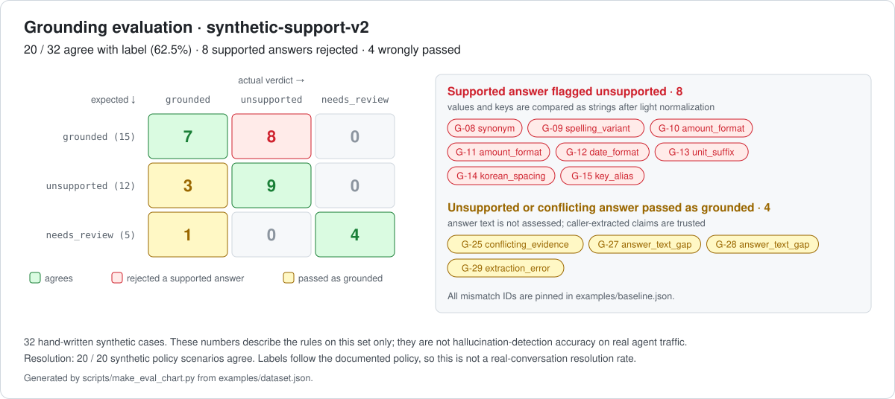

# agent-response-eval-api

Structured claim-evidence consistency check and conversation resolution classification API for AI support agents, with a regression evaluation over a labeled synthetic dataset.

[](https://github.com/DIEGO-LEE-24/agent-response-eval-api/actions/workflows/ci.yml)

- Python 3.11+, FastAPI, Pydantic v2, pytest, Ruff, GitHub Actions
- Rules mode runs offline: no network access, model or API key needed

> **Scope of this repository.** This is a standalone technical sample prepared for the Sendbird AI Agent Engineer Intern application. It is new code that runs on hand-written synthetic data. It does not contain, reproduce or port code or data from any team project (ANCLA, SafeLedger or others), and its results say nothing about those projects.

**My contribution:** Defined API requirements, validation policies, and evaluation criteria; reviewed implementation, tests, and evaluation results. Code was developed with AI coding assistance.

## Architecture



The diagram shows only what exists in `app/`. There is no claim extraction, vector store, conversation storage or streaming in this service.

## Running example



Screenshot of the Swagger UI (`/docs`) served by `uvicorn app.main:app` on a local machine, after executing the `demo-2` request shown under [API examples](#api-examples): evidence says `10 USD`, the claim says `15 USD`, and the server returns `unsupported` with `VALUE_MISMATCH`.

## Endpoints

| Endpoint | Input | What is checked | Not checked |
|---|---|---|---|
| `POST /v1/hallucinations/check` | `answer`, `evidence[]` (source_id/key/value), `claims[]` (key/value/cited_source_ids) | Each **caller-supplied claim** against the supplied evidence and its citations | Any statement in `answer` that was not supplied as a claim. Claim extraction is the caller's job. |
| `POST /v1/resolution/check` | customer confirmation, whether an action was required, tool action status, hand-off, goal present | Conservative status: `resolved` / `unresolved` / `handoff` / `unknown` with a reason code | Conversation text. Inputs are structured signals. |
| `POST /v1/evaluations/run` | labeled cases | Accuracy, confusion matrix, mismatches with category | `mode=llm` cases (rejected with 422) |
| `GET /health` | – | liveness | – |

The rules evaluator reads `answer` only to check whether it is empty. Every grounding response therefore carries `answer_text_assessed: false` and `checked_claims: <n>`, so a client cannot mistake a claim-level pass for a full-text verdict.

### Grounding verdicts

| Code | Meaning | Verdict |
|---|---|---|
| `MISSING_EVIDENCE` | no evidence fact for the claim key | `unsupported` |
| `VALUE_MISMATCH` | claim value differs from every evidence value | `unsupported` |
| `UNKNOWN_SOURCE` | cited source ID was not supplied | `unsupported` |
| `CITATION_MISMATCH` | cited source does not contain that key/value | `unsupported` |
| `CONFLICTING_EVIDENCE` | sources disagree and the claim cites none of the matching ones | `needs_review` |
| `EMPTY_ANSWER`, `NO_EXTRACTED_CLAIMS` | nothing that can be verified | `needs_review` |

`grounded` is returned only when no code fires. Values are compared after case, whitespace and edge-punctuation normalization only, so `$10.00` vs `10 USD` or `dispatched` vs `shipped` are reported as mismatches. This is deliberate; see [Design choices and known limits](#design-choices-and-known-limits).

### Resolution policy (in priority order)

1. hand-off → `handoff`
2. no customer goal → `unknown`
3. customer rejected → `unresolved`
4. required action failed → `unresolved`; pending / not attempted → `unknown`
5. contradictory action signals → `unknown`
6. explicit confirmation → `resolved`; silence → `unknown`

### Optional LLM judge

`mode: "llm"` forwards answer, claims and evidence to an OpenAI-compatible `/chat/completions` endpoint configured through `.env.example` (HTTPS or localhost only). The reply must be JSON with a known verdict, a non-empty reason and only supplied source IDs.

- Not configured → HTTP 503
- Transport or HTTP failure → `needs_review` with `JUDGE_UNAVAILABLE`
- Contract violation → `needs_review` with `JUDGE_INVALID_OUTPUT`

Only mocked tests exist for this path (`httpx.MockTransport`). **No accuracy is claimed for any real model.**

### API examples

The responses below were captured from the running service.

**Unsupported claim**

```bash
curl -s http://127.0.0.1:8000/v1/hallucinations/check -H "Content-Type: application/json" -d '{
  "case_id": "demo-2",
  "answer": "We refunded 15 USD to your card.",
  "evidence": [{"source_id": "refunds:R-81", "key": "refund_amount", "value": "10 USD"}],
  "claims": [{"key": "refund_amount", "value": "15 USD", "cited_source_ids": ["refunds:R-81"]}]
}'
```

```json
{
  "case_id": "demo-2",
  "verdict": "unsupported",
  "violations": [
    {"code": "VALUE_MISMATCH", "claim_key": "refund_amount",
     "detail": "Claim value is not identical to any evidence value after normalization"},
    {"code": "CITATION_MISMATCH", "claim_key": "refund_amount",
     "detail": "Cited source does not contain a matching key/value: refunds:R-81"}
  ],
  "evaluator": "grounding-rules-v2",
  "prompt_version": null,
  "human_review_required": true,
  "checked_claims": 1,
  "answer_text_assessed": false
}
```

**Known limit: unextracted statement passes**

```bash
curl -s http://127.0.0.1:8000/v1/hallucinations/check -H "Content-Type: application/json" -d '{
  "case_id": "demo-1",
  "answer": "Your order shipped. A full refund will be issued tomorrow.",
  "evidence": [{"source_id": "orders:A-1042", "key": "order_status", "value": "shipped"}],
  "claims": [{"key": "order_status", "value": "shipped", "cited_source_ids": ["orders:A-1042"]}]
}'
```

Returns `"verdict": "grounded"` with `"answer_text_assessed": false`: the refund promise was never supplied as a claim, so it was not judged.

**Resolution**

```bash
curl -s http://127.0.0.1:8000/v1/resolution/check -H "Content-Type: application/json" -d '{
  "case_id": "conv-7", "customer_confirmed": true, "requires_action": true, "tool_action_status": "pending"
}'
```

```json
{"case_id": "conv-7", "status": "unknown", "reason_code": "ACTION_NOT_VERIFIED", "evaluator": "resolution-rules-v2"}
```

A thank-you from the customer is not enough while the required action is still pending.

**Dataset evaluation**

```bash
curl -s http://127.0.0.1:8000/v1/evaluations/run -H "Content-Type: application/json" \
  --data-binary @examples/dataset.json
```

Returns per-task accuracy, a confusion matrix and the list of mismatched case IDs with their category.

## Evaluation results



Dataset: `examples/dataset.json` (`synthetic-support-v2`). All cases are hand-written synthetic examples, not production conversations. Labels record what a reviewer would decide; they were written before running the evaluator and were not adjusted afterwards. The chart is generated from the same evaluation by `python scripts/make_eval_chart.py`.

| Task | Cases | Agree with label | Mismatches |
|---|---|---|---|
| Grounding | 32 | 20 (62.5%) | 12 |
| Resolution | 20 distinct scenarios | 20 | 0 |

Grounding confusion matrix (rows = expected, columns = actual):

| expected \ actual | grounded | unsupported | needs_review |
|---|---|---|---|
| grounded (15) | 7 | **8** | 0 |
| unsupported (12) | **3** | 9 | 0 |
| needs_review (5) | **1** | 0 | 4 |

- These figures measure the rules on this synthetic set only. They are **not** a hallucination-detection accuracy for real agent traffic.
- Resolution labels were written from the policy above, so 20/20 shows that the implementation follows that policy. It does not show that the policy is correct for real conversations.
- The 61 passing tests and the 20/32 agreement are different measures: tests check that the code behaves as specified, the evaluation checks how often the rules agree with a reviewer's label.

### The 12 grounding mismatches (kept in `examples/baseline.json`)

| Type | Count | Cases | Cause |
|---|---|---|---|
| Supported answer flagged `unsupported` | 8 | G-08 synonym, G-09 spelling variant, G-10/G-11 amount format, G-12 date format, G-13 unit suffix, G-14 Korean spacing, G-15 key alias | values and keys are compared as strings |
| Unsupported answer passed as `grounded` | 3 | G-27/G-28 statement not supplied as a claim, G-29 caller extracted the evidence value instead of the answer's value | answer text is not assessed; extraction quality is trusted |
| Conflict passed as `grounded` instead of `needs_review` | 1 | G-25 claim cites one side of a conflict | a matching citation is treated as resolving the conflict |

`scripts/run_eval.py --check-baseline` fails if any of these cases changes or any other case breaks, so an improvement has to update the baseline explicitly.

## Run locally

```bash
python -m venv .venv
# Windows: .venv\Scripts\activate    macOS/Linux: source .venv/bin/activate
python -m pip install -e ".[dev]"

uvicorn app.main:app --reload    # http://127.0.0.1:8000/docs
```

Docker:

```bash
docker build -t agent-response-eval-api .
docker run --rm -p 8000:8000 agent-response-eval-api
```

## Tests

```bash
python -m ruff check .
python -m ruff format --check .
python -m pytest
python scripts/run_eval.py --check-baseline
```

| File | Tests | Covers |
|---|---|---|
| `tests/test_rules.py` | 34 | normalization, every grounding code, verdict precedence, resolution policy order, known-gap guards |
| `tests/test_api.py` | 15 | response contract, 422 on malformed payloads, 503 when the judge is not configured, dataset/baseline consistency |
| `tests/test_llm.py` | 12 | judge request shape, `JUDGE_UNAVAILABLE` vs `JUDGE_INVALID_OUTPUT` (mocked transport only) |

**61 tests pass.** Passing tests means the code behaves as specified, including the documented gaps. It is a different measure from the evaluation accuracy above.

`.github/workflows/ci.yml` runs on every push and pull request with Python 3.12: install, `ruff check`, `ruff format --check`, `pytest`, and the baseline check. The badge at the top links to the run history.

## Design choices and known limits

Design choices, in order of importance (also in the `app/rules.py` docstring):

1. **Fail closed.** Anything the rules cannot verify becomes `needs_review` or `unsupported`; `grounded` is only returned when every supplied claim matches supplied evidence.
2. **Explicit scope.** The grounding evaluator compares structured claims with structured evidence. It does not read the natural-language answer, so it cannot catch statements that were never extracted as claims. That gap is covered by a regression test and the `answer_text_assessed: false` field instead of being hidden.
3. **Conservative string comparison over fuzzy matching.** Synonyms, currency formats and unit suffixes are reported as mismatches; the dataset records them as known false positives rather than tuning them away.

Known limits:

- Only caller-supplied structured claims are verified; claim extraction is out of scope.
- No semantic matching: synonyms, number/date formats and key aliases produce false `unsupported`.
- The dataset is small and synthetic; no real conversation data was used.
- The LLM judge path is tested with mocked responses only.

## Layout

```
app/
  schemas.py     request/response contracts (extra fields rejected)
  rules.py       grounding and resolution rules
  llm.py         optional remote judge
  evaluation.py  metrics and mismatches
  main.py        FastAPI routes
prompts/         versioned judge prompt
examples/        synthetic dataset and recorded baseline
scripts/         offline evaluation, baseline check, chart rendering
tests/           rules, API contract, mocked LLM judge
docs/assets/     architecture diagram, Swagger UI screenshot, evaluation chart
```

## License

MIT
